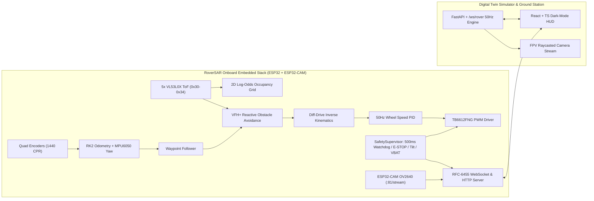

# RoverSAR System Architecture

## 1. Overview
**RoverSAR** is an autonomous differential-drive search-and-rescue (SAR) ground robot engineered with identical control mathematics across its **ESP32-WROOM-32D PlatformIO C++ firmware** and its **Python FastAPI + WebSocket 2D physics/SLAM digital simulator**, controlled in real time via a responsive **React + TypeScript ground control HUD**.

## 2. Firmware Module Boundaries (`firmware/`)
- **`motor_control/`**:
  - `DiffDriveKinematics`: Converts body twist $(v, \omega)$ into left/right wheel angular velocities $(\omega_L, \omega_R)$ with curvature-preserving saturation (`WHEEL_RADIUS_M = 0.0325 m`, `WHEEL_BASE_M = 0.160 m`).
  - `WheelPidController`: Discrete PID + feedforward + conditional-integration anti-windup running at `50 Hz`.
  - `MotorDriver`: `20 kHz` 10-bit LEDC PWM driver supporting TB6612FNG (`STBY` hardware standby) and L298N.
- **`sensors/`**:
  - `Vl53l0xArray`: Initializes five `VL53L0X` ToF sensors sharing `I2C (GPIO21/22)` via sequential `XSHUT` toggling to unique addresses `0x30..0x34` across `[-60°, -30°, 0°, +30°, +60°]`.
  - `Mpu6050Imu`: Startup gyro bias calibration + complementary roll/pitch/yaw fusion at `0x68`.
  - `EncoderOdometry`: State-table `IRAM_ATTR` quadrature ISRs + mid-point RK2 pose integration fused with IMU yaw rate.
  - `BatteryMonitor`: ADC1 calibrated 2S Li-Ion monitor via `22 kΩ / 10 kΩ` divider on `GPIO33`.
- **`navigation/`**:
  - `OccupancyGrid2D`: Compact `int8_t` log-odds grid updated via Bresenham line-of-sight raycasting.
  - `VfhPlanner`: 36-sector Vector Field Histogram reactive avoidance + `< 0.22 m` emergency spin recovery.
  - `WaypointFollower`: Goal-seeking controller feeding desired heading error into `VfhPlanner`.
- **`safety/`**:
  - `CommWatchdog`: Enforces mandatory `<= 500 ms` heartbeat period; expired heartbeat immediately clears `STBY` and halts PWM.
  - `SafetySupervisor`: Evaluates hardware NC E-STOP (`GPIO32`), latched software E-STOP, IMU rollover (`|roll|,|pitch| > 35°`), critical battery (`<= 6.0V` for `>= 1s`), and comm-loss watchdog.
- **`communication/` & `camera/`**:
  - `WsTelemetryServer`: Built-in RFC-6455 WebSocket + HTTP JSON telemetry & command server.
  - `Esp32CamLink`: Non-blocking TCP stream monitor & tilt tracker for the companion AI-Thinker ESP32-CAM.

## 3. Simulator & Dashboard (`simulator/` & `dashboard/`)
- **Physics & Raycasting**: `RoverSimulationEngine` executes at `50 Hz`, simulating first-order motor inertia (`τ = 75 ms`), quadrature encoder counts, 5-beam raycasting against indoor SAR walls/rubble, and 2D Bayesian occupancy grid mapping (`100×100` cells @ `0.10 m`).
- **FPV Camera Stream**: `simulator/camera_feed.py` raycasts a 64° horizontal FOV perspective corridor view with survivor beacon markers and overlays real-time ToF clearance and fault telemetry into JPEG/MJPEG streams.
- **Ground Station HUD**: Compiled React 18 + TypeScript + Vite bundle served directly at `/` by FastAPI, featuring touch + WASD driving, interactive map click-to-waypoint, live laser scan & occupancy canvas, RPM/battery/watchdog gauges, E-STOP, and **Simulate Comm Loss** button.

## 4. Simulator-Independent HAL & Wokwi Architecture (`simulation/` & `wokwi/`)
RoverSAR decouples its firmware/control contracts from any single simulator backend via the canonical HAL in `simulation/adapters/common/rover_hal_interface.h` and `rover_hal_interface.py` (`RoverHalProtocol`).

- **Active Microcontroller Simulator — Wokwi (`wokwi/` + `simulation/adapters/wokwi/`)**:
  - `wokwi/wokwi.toml` loads the PlatformIO-compiled `firmware/.pio/build/esp32dev/firmware.bin` and `firmware.elf`.
  - **Natively supported in Wokwi**: `board-esp32-devkit-c-v4`, `wokwi-mpu6050` (`GPIO21/22`), `wokwi-hc-sr04` (`GPIO15/12`), `wokwi-pushbutton` NC E-STOP (`GPIO32`), `wokwi-potentiometer` 2S battery divider (`GPIO33`), and `wokwi-led` PWM/fault indicators (`GPIO25/19/2`).
  - **Unsupported natively (Custom Chip Stubs + 50 Hz Python Harness, never silently substituted)**: 5-channel `VL53L0X` ToF array (`chip-vl53l0x-array`), `TB6612FNG` + 1440 CPR quadrature encoders (`chip-quad-encoder`), and `ESP32-CAM` MJPEG stream (`simulator/camera_feed.py`). See `simulation/documentation/COMPONENT-SUPPORT-MATRIX.md`.
- **Preserved BenchTwin Adapter (`benchtwin/` + `simulation/adapters/benchtwin/`)**:
  - All BenchTwin assets (`roversar.btw`, `roversar-benchtwin.json`, `roversar.net`, `BOM.csv`, `roversar_base_plate.stl`) remain intact with `status: "preserved_dormant"` in `benchtwin_adapter_manifest.json`.
  - **Reactivation**: Open `benchtwin/roversar.btw` in BenchTwin, implement `RoverHalProtocol` in `simulation/adapters/benchtwin/`, and switch the active simulator profile from `wokwi` to `benchtwin`.
